<p align="center">
  <a href="https://honear.fr"></a>
</p>

<p align="center">
  <a href="https://honear.fr"></a>
  <a href="https://github.com/SNZMTO/honear/actions/workflows/tests.yml"></a>
  
  
  
  
</p>

> 🇫🇷 The French version comes first: [README.md](README.md). This page is its English translation. The game itself, and
> the pictures drawn by its renderer, are in French.

Honear is a multiplayer music blind test, live at [honear.fr](https://honear.fr). A shared screen shows a low-poly hi-fi
cabinet, everyone answers from their phone, and a Node/WebSocket server keeps every game in sync.


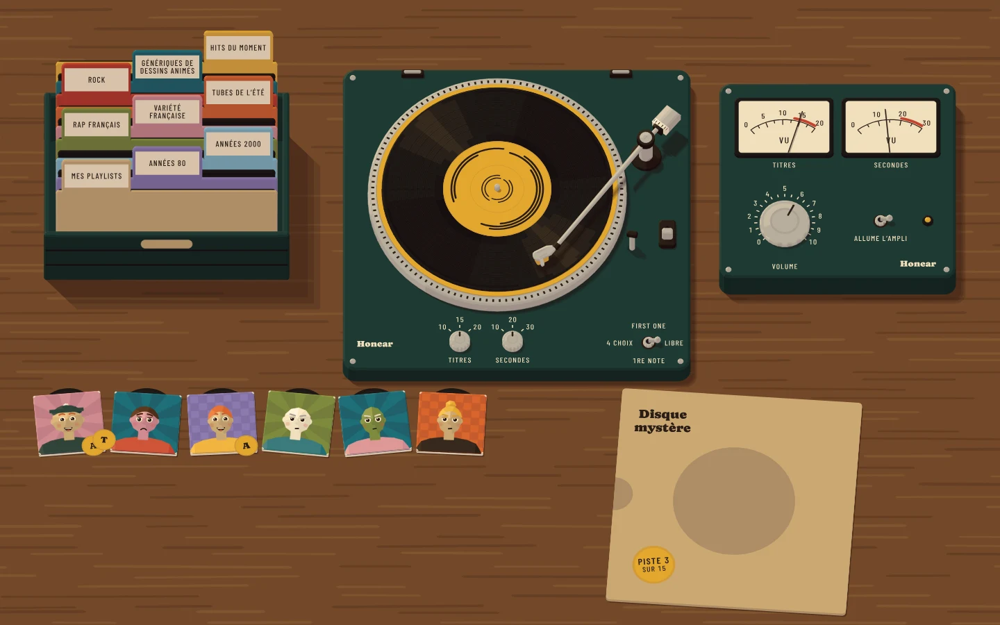

| The home page, on honear.fr | The reveal and the points |
| :---: | :---: |
| 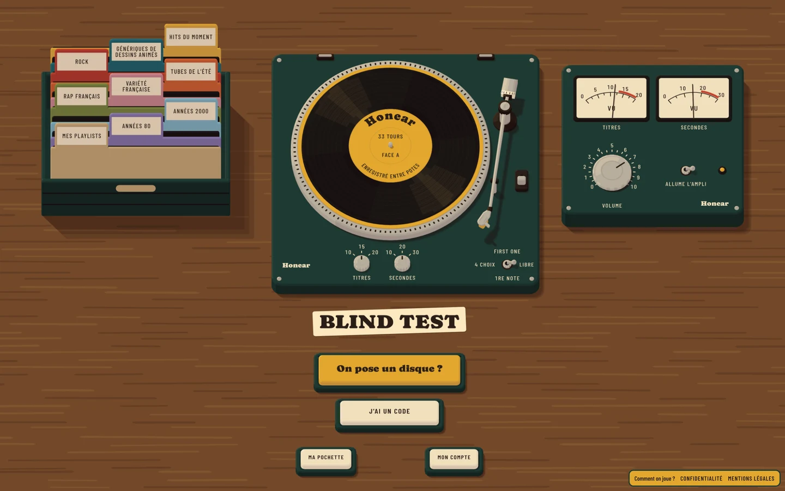 | 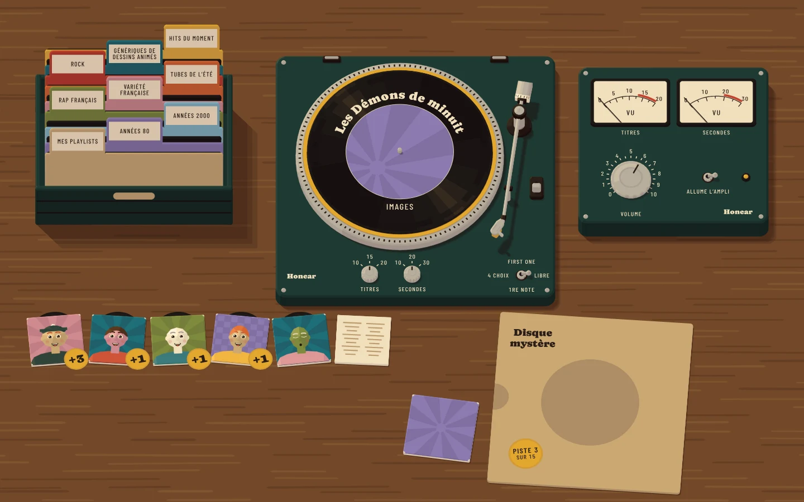 |

### How to play

1. **Put a record on.** The host opens [honear.fr](https://honear.fr) on a computer or a TV.
2. **Join the room.** Everyone enters the code, or scans the QR code, with their phone.
3. **Make your sleeve.** An avatar, a pattern, an artist name: it stands for you on the cabinet.
4. **Pick a crate.** Ready-made themes, any public Deezer playlist, or a list made to measure by an assistant, with
   [the Honear MCP](https://github.com/SNZMTO/honear-mcp).
5. **Guess.** Thirty seconds per clip, typed freely or picked among four choices. The chart follows each track, and the final
   closes the game.

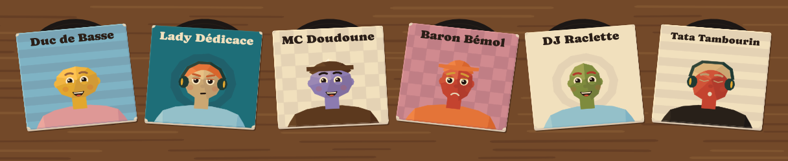

Accounts are optional: they keep the sleeve and the scores, and open with a link sent by e-mail or with a password.


<table>
  <tr>
    <td align="center" width="33%"><a href="#going-to-production">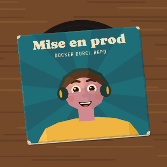</a></td>
    <td align="center" width="33%"><a href="#tests-in-the-green">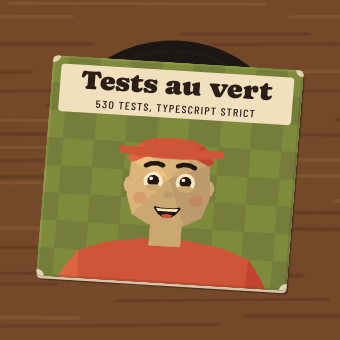</a></td>
    <td align="center" width="33%"><a href="#everyone-in-time">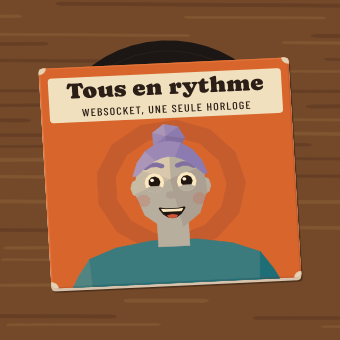</a></td>
  </tr>
  <tr>
    <td align="center"><b>In production, securely</b></td>
    <td align="center"><b>Code held by its tests</b></td>
    <td align="center"><b>Real-time multiplayer</b></td>
  </tr>
</table>

<p align="center">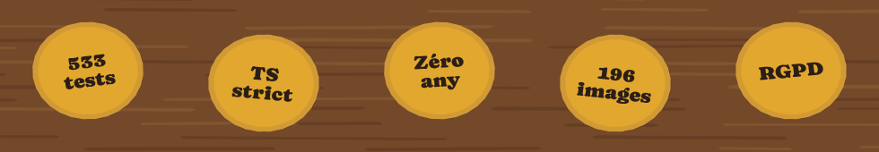</p>

### Going to production

- **The container** ([`Dockerfile`](Dockerfile)): a Node image pinned by its digest, built in two stages; the final image no
  longer has npm, runs without root privileges and monitors itself (`/sante`).
- **How it runs** ([`deploiement/compose.yaml`](deploiement/compose.yaml)): read-only file system, every Linux capability
  dropped, `no-new-privileges`, process and memory limits, no published port: the game is only reachable behind the VPS's
  HTTPS front.
- **Deployment** ([`deploiement/mettre-en-ligne.sh`](deploiement/mettre-en-ligne.sh)) refuses a repository with uncommitted
  changes, tags the image with the commit, keeps the last three (the new one and the two before) to roll back, and waits for
  the game to answer.
- **Secrets** are never in the repository: they live on the machine, in files readable by root only.
- **The page** is served under a strict security policy (CSP, `nosniff`, `no-referrer`, no iframe). The WebSocket checks the
  origin and the size of messages, and caps the rate of each connection; a single address (the one the front saw) can connect
  thirty phones and open three rooms at most.
- **Accounts**: single-use links, passwords hashed with scrypt and compared in constant time, limited attempts, a file
  rewritten atomically.
- **Players' data** has its GDPR register ([`RGPD.md`](RGPD.md), in French): what is kept and why, the players' rights, and
  what to do if something leaks.

### Tests in the green

- **TypeScript at its strictest** (`strict`, `noUncheckedIndexedAccess`, `exactOptionalPropertyTypes`…), with no `any`.
- **Over 500 tests**, about fifteen of which check the architecture itself ([`tests/sources.test.ts`](tests/sources.test.ts)):
  each layer only reads the ones below it, no colour outside the palette, no duration written as a bare number, no
  `Math.random`.
- **Deterministic rendering**: randomness is a seed and the time is read in one place only, so the same state always gives the
  same picture. `npm run controle` measures every picture of the project (contrasts, text sizes, weight of the drawing).
- **The page's script** is checked against what browsers knew five years ago (ES2019).

### Everyone in time

- A Node server keeps the rooms in memory, with a single clock for all the phones: everyone hears and sees the same thing at
  the same moment.
- The server decides everything and sends each player only what they are allowed to know. A phone that loses the network
  comes back into its game.
- Calls to Deezer leave from the server, never from the phones. They are spread out under the rate limit and cached, and the
  clip links, which expire, are read again before a track starts.

### Everything is drawn by the code

The interface has no hand-drawn image: the cabinet, the turntable, the players' sleeves and the badges are low-poly SVG,
computed from a palette of seventeen colours and two fonts (only the album covers come from Deezer). The turntable, exploded
layer by layer:

<p align="center">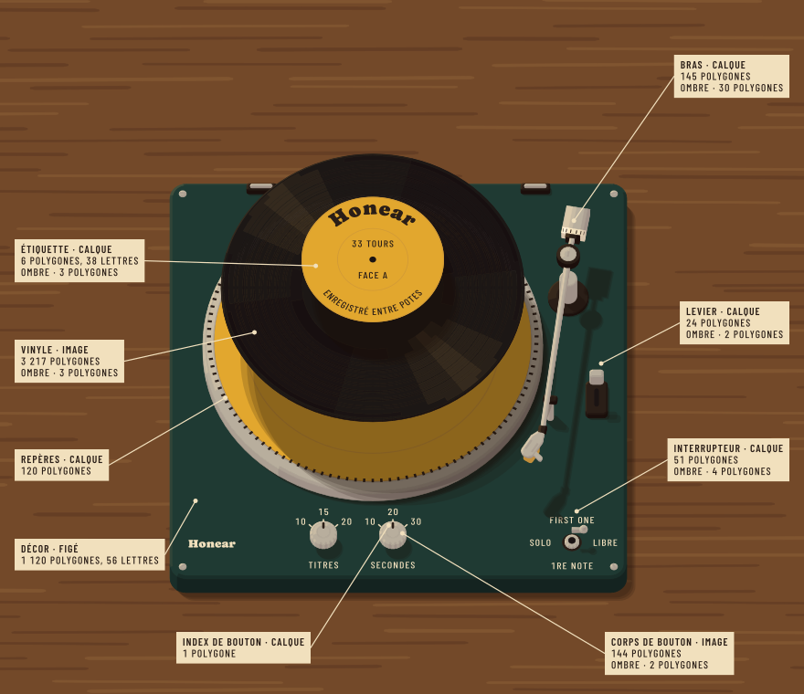</p>

The pictures on this page come from the same engine: `npm run vitrine` redraws them.

### The architecture

The code is split into layers, each in its own folder under [`src/`](src). An arrow means "reads"; a test rejects any import
that would step outside this graph.

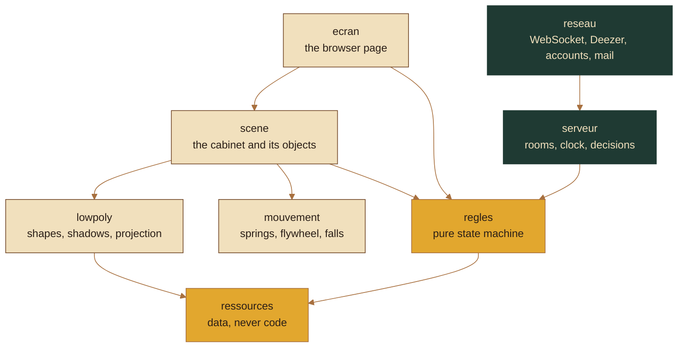

In cream, what runs in the browser; in bottle green, what runs on the server; in honey, what both share. The detail of each
module is in [`LISEZMOI.md`](LISEZMOI.md), the server and the wire protocol in [`NOTES-TECHNIQUES.md`](NOTES-TECHNIQUES.md),
the hosting in [`HEBERGEMENT.md`](HEBERGEMENT.md) (all three in French).

### Running it locally

You need Node 22 or newer; production and CI run on Node 24.

```sh
npm ci
npm test                            # the types, then every test
npm run construire && npm run site  # the game on http://127.0.0.1:8080
```

To connect phones from the local network: `HOTE=0.0.0.0 npm run site`. Without network access to Deezer,
`npm run prototype` writes a game playable from end to end against a simulated server (`sortie/prototype.html`).


Honear is my project, from the idea to putting it online. Claude Code writes most of the code and the tests, and the
co-signed commits show it; I design, I set the rules that the tests check, I make the calls (often on its recommendations)
and I try things on real phones.

- **Design before coding.** The game went through seven steps, each validated on boards before the next: the drawing, the
  animation, the visual system, the phone screens, the host screen, then a prototype playable against a simulated server. The
  boards are still there ([`src/planche/`](src/planche)), and every choice is recorded in the LISEZMOI, under "Ce qui a été
  tranché" (what was decided).
- **Rules that check themselves.** Every architecture rule is a test: a red test is a broken rule, not a test to change. The
  code cannot drift without it showing, whichever hand writes it.
- **Written instructions** ([`CLAUDE.md`](CLAUDE.md)): the commands, the deployment, and what must never be touched, such as
  the mail password, the players' accounts or a secret on GitHub.
- **Trying on real phones.** Several bugs only showed on iPhone: the page can send a diagnostic to the server's log, and two
  "mobile audit" passes followed.
- **Reviewing.** The commits keep the trace of what review corrected.
- **The history.** This repository starts on 12 October 2026. Its first commit imports the whole project in one block; until
  then it was developed elsewhere under its former name, Miel d'oreilles, in a Claude Code session. Every commit is in my name
  and co-signed by Claude (the history was rewritten on 18 October for that, without changing their content): `git blame`
  therefore attributes most lines to me, but Claude wrote them. The earlier path can be read in the boards and in the "Ce qui a
  été tranché" sections of the LISEZMOI.

<br>

<p align="center">
  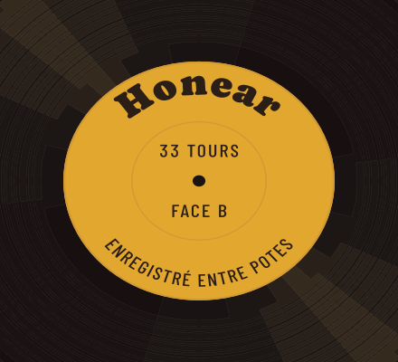<br>
  <a href="https://honear.fr">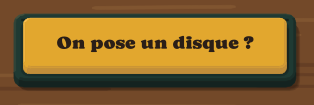</a>
</p>

<p align="center"><sub>© 2026 Mateo Sanchez, all rights reserved: the code is public to be read, not to be reused without my
agreement. The Caprasimo and Barlow Condensed fonts keep their licence (<a href="polices/LICENCES.md">polices/LICENCES.md</a>).
The clips come from Deezer's API: no music is hosted here.</sub></p>
