<p align="center">
  <a href="https://honear.fr"></a>
</p>

<p align="center">
  <a href="https://honear.fr"></a>
  <a href="https://github.com/SNZMTO/honear/actions/workflows/tests.yml"></a>
  
  
  
  
</p>

> **In English.** Honear is a multiplayer music blind test, live at [honear.fr](https://honear.fr). A shared screen shows a
> low‑poly hi‑fi cabinet, everyone answers from their phone, and a Node/WebSocket server keeps every game in sync. Strict
> TypeScript, 541 tests (some of which enforce the architecture itself), a hardened Docker deployment and a GDPR register.
> Every picture on this page is drawn by the game's own renderer. Code and docs are in French.


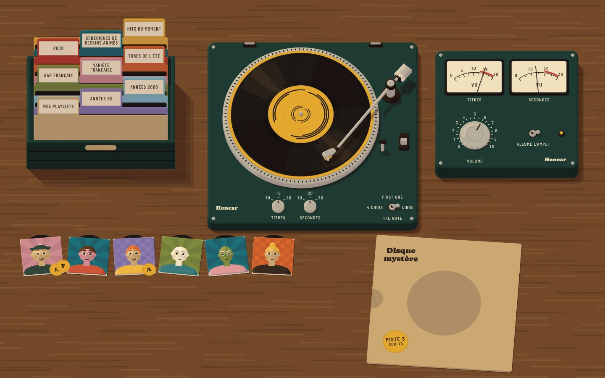

| L'accueil, sur honear.fr | La révélation et les points |
| :---: | :---: |
| 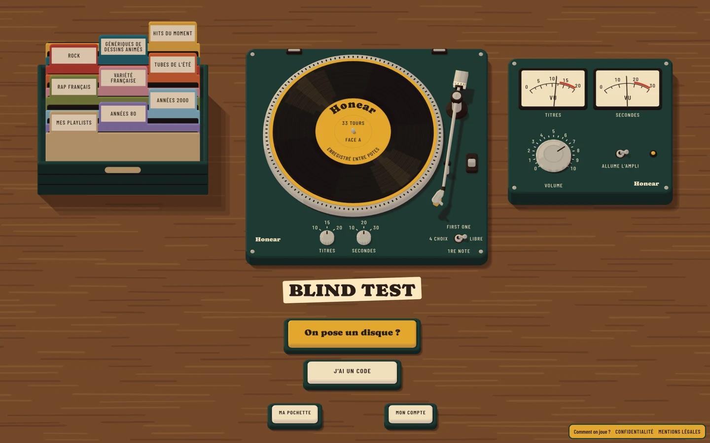 | 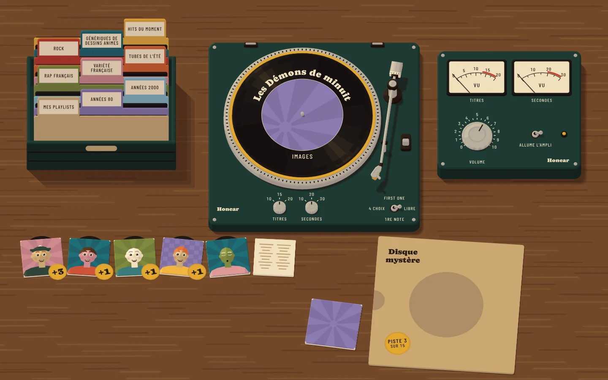 |

### Comment on joue

1. **On pose un disque.** L'hôte ouvre [honear.fr](https://honear.fr) sur un ordinateur ou une télé.
2. **On rejoint le salon.** Chacun entre le code, ou scanne le QR code, avec son téléphone.
3. **On se fait une pochette.** Un avatar, un motif, un nom d'artiste : c'est elle qui vous représente sur le meuble.
4. **On choisit un bac.** Des thèmes prêts, ou n'importe quelle playlist Deezer ou Spotify publique.
5. **On devine.** Trente secondes par extrait, en saisie libre ou en quatre choix. Le hit-parade suit chaque piste, la finale
   clôt la partie.

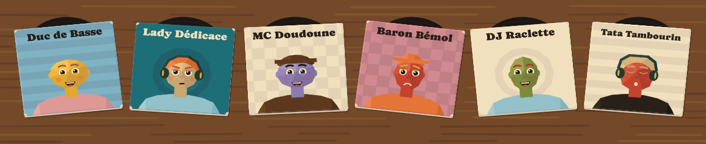

Les comptes sont facultatifs : ils gardent la pochette et les scores, et s'ouvrent par un lien envoyé par e-mail ou par un mot de
passe.


<table>
  <tr>
    <td align="center" width="33%"><a href="#mise-en-prod">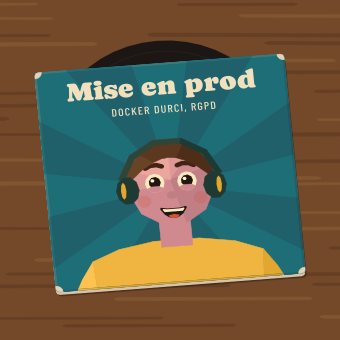</a></td>
    <td align="center" width="33%"><a href="#tests-au-vert">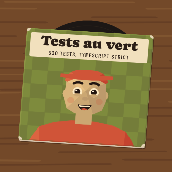</a></td>
    <td align="center" width="33%"><a href="#tous-en-rythme">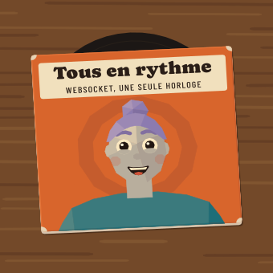</a></td>
  </tr>
  <tr>
    <td align="center"><b>En production, en sécurité</b></td>
    <td align="center"><b>Un code tenu par ses tests</b></td>
    <td align="center"><b>Du multijoueur en temps réel</b></td>
  </tr>
</table>

<p align="center">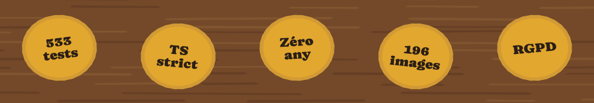</p>

### Mise en prod

- **Le conteneur** ([`Dockerfile`](Dockerfile)) : une image Node épinglée par son empreinte, construite en deux étapes ; l'image
  finale n'a plus npm, tourne sans les droits root et se surveille elle-même (`/sante`).
- **Son exécution** ([`deploiement/compose.yaml`](deploiement/compose.yaml)) : système de fichiers en lecture seule, toutes les
  capacités Linux retirées, `no-new-privileges`, limites de processus et de mémoire, aucun port publié : le jeu ne se joint que
  derrière le frontal HTTPS du VPS.
- **La mise en ligne** ([`deploiement/mettre-en-ligne.sh`](deploiement/mettre-en-ligne.sh)) refuse un dépôt qui a des
  changements, étiquette l'image au commit, garde les trois précédentes pour revenir en arrière, et attend que le jeu réponde.
- **Les secrets** ne sont jamais dans le dépôt : ils vivent sur la machine, dans des fichiers lisibles par root seul.
- **La page** est servie sous une politique de sécurité stricte (CSP, `nosniff`, `no-referrer`, pas d'iframe). Le WebSocket
  vérifie l'origine, la taille des messages et le débit de chaque adresse.
- **Les comptes** : liens à usage unique, mots de passe hachés par scrypt et comparés en temps constant, essais limités, fichier
  réécrit de façon atomique.
- **Les données des joueurs** ont leur registre RGPD ([`RGPD.md`](RGPD.md)) : ce qui est gardé et pourquoi, les droits des joueurs,
  et quoi faire si quelque chose fuit.

### Tests au vert

- **TypeScript au plus strict** (`strict`, `noUncheckedIndexedAccess`, `exactOptionalPropertyTypes`…), sans `any`.
- **541 tests**, dont une vingtaine qui vérifient l'architecture elle-même ([`tests/sources.test.ts`](tests/sources.test.ts)) :
  chaque couche ne lit que celles du dessous, aucune couleur hors de la palette, aucune durée écrite en chiffres, aucun
  `Math.random`.
- **Un rendu déterministe** : le hasard est une graine et l'heure ne se lit qu'à un endroit, donc le même état redonne toujours la
  même image. `npm run controle` mesure les 199 images du projet (contrastes, taille des textes, poids du dessin).
- **Le script de la page** est vérifié contre ce que savaient les navigateurs d'il y a cinq ans (ES2019).

### Tous en rythme

- Un serveur Node tient les salons en mémoire, avec une seule horloge pour tous les téléphones : chacun entend et voit la même
  chose au même moment.
- Le serveur décide de tout et n'envoie à chacun que ce qu'il a le droit de savoir. Un téléphone qui perd le réseau revient dans sa
  partie.
- Les appels à Deezer partent du serveur, jamais des téléphones. Ils sont étalés sous la limite de débit et gardés en cache, et
  les liens d'extraits, qui expirent, sont relus avant qu'on lance la piste.

### Tout est dessiné par le code

Aucune image dans le jeu : le meuble, la platine, les pochettes et les pastilles sont du SVG en low-poly, calculé à partir d'une
palette de dix-sept couleurs et de deux polices. La platine, éclatée calque par calque :

<p align="center">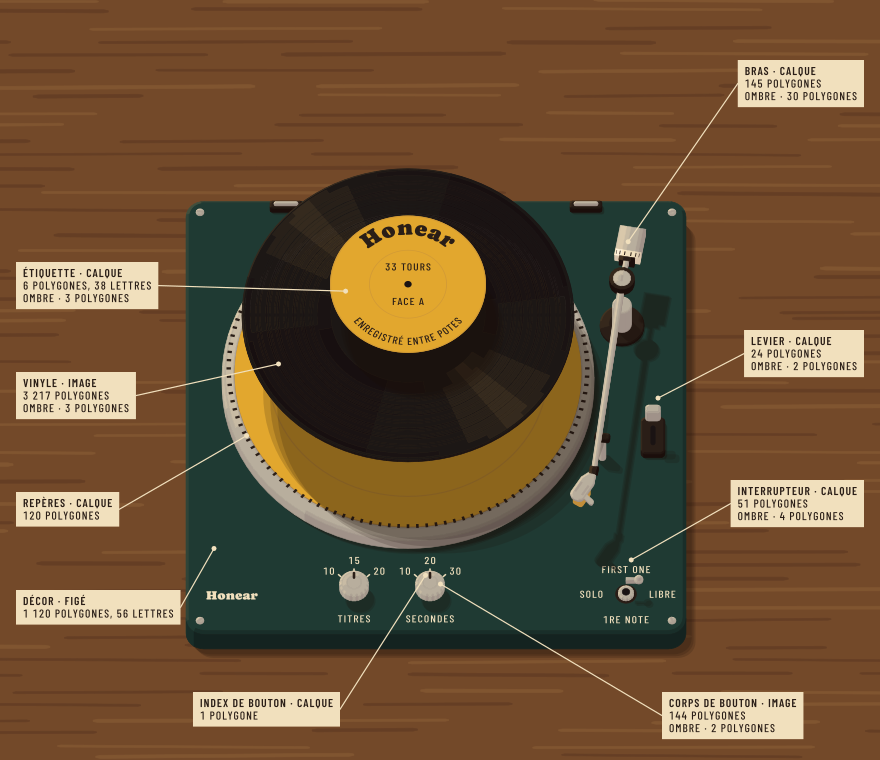</p>

Les images de cette page viennent du même moteur : `npm run vitrine` les redessine.

### L'architecture

Le code est découpé en couches, chacune dans son dossier de [`src/`](src). Une flèche veut dire « lit » ; un test refuse tout
import qui sortirait de ce graphe.

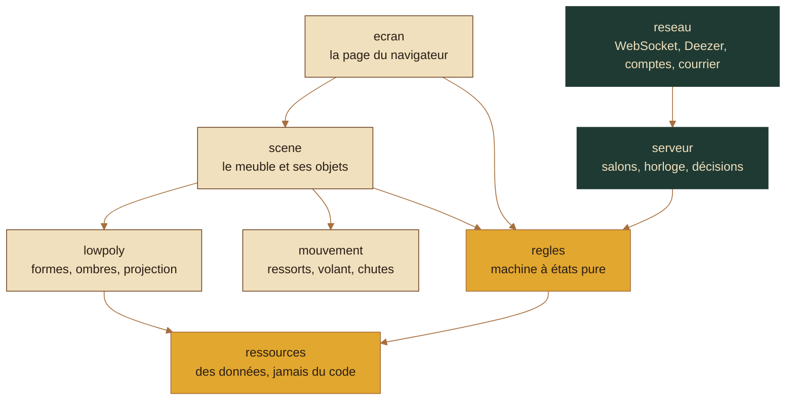

En crème, ce qui tourne dans le navigateur ; en vert bouteille, ce qui tourne sur le serveur ; en miel, ce que les deux partagent.
Le détail de chaque module est dans [`LISEZMOI.md`](LISEZMOI.md), le serveur et la ligne dans
[`NOTES-TECHNIQUES.md`](NOTES-TECHNIQUES.md), l'hébergement dans [`HEBERGEMENT.md`](HEBERGEMENT.md).

### Lancer en local

Il faut Node 22.

```sh
npm ci
npm test                            # les types, puis les 541 tests
npm run construire && npm run site  # le jeu sur http://127.0.0.1:8080
```

Pour y brancher les téléphones du réseau local : `HOTE=0.0.0.0 npm run site`. Sans réseau vers Deezer, `npm run prototype` écrit
une partie jouable de bout en bout contre un serveur simulé (`sortie/prototype.html`).


Honear est mon projet de bout en bout : l'idée, le meuble et son style, le découpage en couches, les règles du code, la
sécurité et l'hébergement. Pour écrire le code, je travaille avec un assistant de code, Claude Code, et les commits co-signés
le montrent. Il écrit vite ; c'est moi qui pose le cadre, qui tranche et qui vérifie.

- **Concevoir avant de coder.** Le jeu est passé par sept étapes, chacune validée sur des planches avant la suivante : le
  dessin, l'animation, le système visuel, les écrans du téléphone, l'écran de l'hôte, puis un prototype jouable contre un
  serveur simulé. Les planches sont toujours là ([`src/planche/`](src/planche)), et chaque choix est noté dans le LISEZMOI, à
  « Ce qui a été tranché ».
- **Des règles qui se vérifient seules.** Chaque règle d'architecture est un test : un test rouge, c'est une règle enfreinte,
  pas un test à changer. Le code ne peut pas dériver sans que ça se voie, quelle que soit la main qui l'écrit.
- **Des consignes écrites** ([`CLAUDE.md`](CLAUDE.md)) : les commandes, la mise en ligne, et ce à quoi on ne touche jamais, comme
  le mot de passe du courrier, les comptes des joueurs ou un secret sur GitHub.
- **Essayer sur de vrais téléphones.** Plusieurs bugs ne se voyaient que sur iPhone : la page sait envoyer un diagnostic au
  journal du serveur, et deux passes d'« audit mobile » ont suivi.
- **Relire.** Les commits gardent la trace de ce que la relecture a corrigé.
- **L'historique.** Ce dépôt commence le 12 octobre 2026. Son premier commit importe d'un bloc le projet, développé jusque-là
  ailleurs sous son ancien nom, Miel d'oreilles ; il est signé Claude parce qu'il est parti d'une session Claude Code. Le chemin
  d'avant se lit dans les planches et dans les « Ce qui a été tranché » du LISEZMOI.

<br>

<p align="center">
  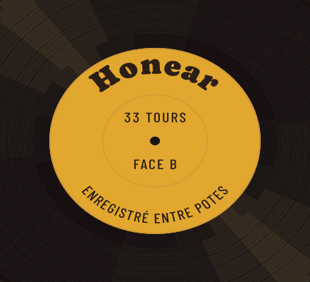<br>
  <a href="https://honear.fr">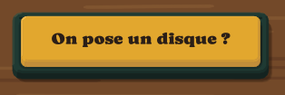</a>
</p>

<p align="center"><sub>© 2026 Mateo Sanchez, tous droits réservés : le code est public pour être lu, pas pour être réutilisé sans
mon accord. Les polices Caprasimo et Barlow Condensed gardent leur licence (<a href="polices/LICENCES.md">polices/LICENCES.md</a>).
Les extraits viennent de l'API de Deezer : aucune musique n'est hébergée ici.</sub></p>
