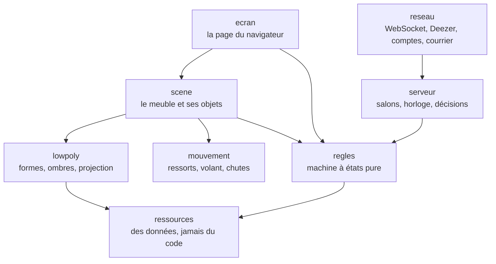

# Honear

[](https://github.com/SNZMTO/honear/actions/workflows/tests.yml)
&nbsp;**En ligne : [honear.fr](https://honear.fr)**

Le blind test entre potes : un écran pour la tablée, un téléphone chacun, et des extraits de 30 secondes à reconnaître.

> **In English.** Honear is a multiplayer music blind test, live at [honear.fr](https://honear.fr). A shared screen shows a
> low‑poly hi‑fi cabinet, everyone answers from their phone, and a Node/WebSocket server keeps every game in sync. Strict
> TypeScript, 523 tests (some of which enforce the architecture itself), a hardened Docker deployment and a GDPR register.
> Built with Claude Code: the last section explains how. Code and docs are in French.


| L'accueil, sur honear.fr | La révélation et les points |
| --- | --- |
|  |  |

## Comment on joue

L'hôte ouvre le site sur un ordinateur ou une télé et pose un disque. Les autres rejoignent le salon depuis leur téléphone, par un
code ou un QR code, et se font une pochette d'artiste. On choisit une playlist dans le bac (des thèmes prêts, ou n'importe quelle
playlist Deezer ou Spotify publique), puis chaque extrait se devine en saisie libre ou en quatre choix. Le hit-parade suit chaque
piste, la finale clôt la partie. Les comptes sont facultatifs : ils gardent la pochette et les scores, et s'ouvrent par un lien
envoyé par e-mail ou par un mot de passe.

## Ce que le projet montre

### En production, en sécurité

- **Le conteneur** ([`Dockerfile`](Dockerfile)) : une image Node épinglée par son empreinte, construite en deux étapes ; l'image
  finale n'a plus npm, tourne sans les droits root et se surveille elle-même (`/sante`).
- **Son exécution** ([`deploiement/compose.yaml`](deploiement/compose.yaml)) : système de fichiers en lecture seule, toutes les
  capacités Linux retirées, `no-new-privileges`, limites de processus et de mémoire, aucun port publié : le jeu ne se joint que
  derrière le frontal HTTPS du VPS.
- **La mise en ligne** ([`deploiement/mettre-en-ligne.sh`](deploiement/mettre-en-ligne.sh)) : elle refuse un dépôt qui a des
  changements, étiquette l'image au commit, garde les trois précédentes pour revenir en arrière, et attend que le jeu réponde.
- **Les secrets** ne sont jamais dans le dépôt : ils vivent sur la machine, dans des fichiers lisibles par root seul.
- **La page** est servie sous une politique de sécurité stricte (CSP, `nosniff`, `no-referrer`, pas d'iframe). Le WebSocket
  vérifie l'origine, la taille des messages et le débit de chaque adresse.
- **Les comptes** : liens à usage unique, mots de passe hachés par scrypt et comparés en temps constant, essais limités, fichier
  réécrit de façon atomique.
- **Les données des joueurs** ont leur registre RGPD ([`RGPD.md`](RGPD.md)) : ce qui est gardé et pourquoi, les droits des joueurs,
  et quoi faire si quelque chose fuit.

### Un code tenu par ses tests

- **TypeScript au plus strict** (`strict`, `noUncheckedIndexedAccess`, `exactOptionalPropertyTypes`…), sans `any`.
- **523 tests**, dont une vingtaine qui vérifient l'architecture elle-même ([`tests/sources.test.ts`](tests/sources.test.ts)) :
  chaque couche ne lit que celles du dessous, aucune couleur hors de la palette, aucune durée écrite en chiffres, aucun
  `Math.random`.
- **Un rendu déterministe** : le hasard est une graine et l'heure ne se lit qu'à un endroit, donc le même état redonne toujours la
  même image. `npm run controle` mesure les 196 images du projet (contrastes, taille des textes, poids du dessin).
- **Le script de la page** est vérifié contre ce que savaient les navigateurs d'il y a cinq ans (ES2019).

### Du multijoueur en temps réel

- Un serveur Node tient les salons en mémoire, avec une seule horloge pour tous les téléphones : chacun entend et voit la même
  chose au même moment.
- Le serveur décide de tout et n'envoie à chacun que ce qu'il a le droit de savoir. Un téléphone qui perd le réseau revient dans sa
  partie.
- Les appels à Deezer partent du serveur, jamais des téléphones. Ils sont étalés sous la limite de débit et gardés en cache, et
  les liens d'extraits, qui expirent, sont relus avant qu'on lance la piste.
- Tout le dessin est du SVG calculé par le code, en low-poly, sans une seule image.

## L'architecture

Le code est découpé en couches, chacune dans son dossier de [`src/`](src). Une flèche veut dire « lit » ; un test refuse tout
import qui sortirait de ce graphe.



Le détail de chaque module est dans [`LISEZMOI.md`](LISEZMOI.md), le serveur et la ligne dans
[`NOTES-TECHNIQUES.md`](NOTES-TECHNIQUES.md), l'hébergement dans [`HEBERGEMENT.md`](HEBERGEMENT.md).

## Lancer en local

Il faut Node 22.

```sh
npm ci
npm test                          # les types, puis les 523 tests
npm run construire && npm run site  # le jeu sur http://127.0.0.1:8080
```

Pour y brancher les téléphones du réseau local : `HOTE=0.0.0.0 npm run site`. Sans réseau vers Deezer, `npm run prototype` écrit
une partie jouable de bout en bout contre un serveur simulé (`sortie/prototype.html`).

## Comment je l'ai construit avec Claude Code

Honear est écrit avec Claude Code. Le code, les tests et la plupart des messages de commit viennent de Claude, et le premier commit,
qui apporte les sept étapes de conception, est à son nom. Mon travail, c'est le cadre, les décisions et la vérification.

- **Un cadre écrit.** [`CLAUDE.md`](CLAUDE.md) fixe les règles du code, les commandes, la mise en ligne et ce à quoi on ne touche
  jamais : le mot de passe du courrier, les comptes des joueurs, aucun secret sur GitHub. Il fixe aussi la façon de travailler :
  un plafond de temps par tour, une seule passe de vérification, et s'arrêter au premier outil qui bloque au lieu de le contourner.
- **Des règles qui se vérifient seules.** Chaque règle d'architecture est un test : un test rouge, c'est une règle enfreinte, pas
  un test à changer. C'est ce qui empêche le code de dériver d'une session à l'autre.
- **Concevoir avant de coder.** Le jeu est passé par sept étapes, chacune rendue en planches avant la suivante : le dessin,
  l'animation, le système visuel, les écrans du téléphone, l'écran de l'hôte, puis un prototype jouable contre un serveur simulé.
  Les planches sont toujours là ([`src/planche/`](src/planche)), et chaque choix est noté dans le LISEZMOI, à « Ce qui a été
  tranché ».
- **Essayer sur de vrais téléphones.** Plusieurs bugs ne se voyaient que sur iPhone : la page sait envoyer un diagnostic au
  journal du serveur, et deux passes d'« audit mobile » ont suivi.
- **Relire.** Les commits gardent la trace de ce que la relecture a corrigé.

## Droits

© 2026 Mateo Sanchez, tous droits réservés. Le code est public pour être lu, pas pour être réutilisé sans mon accord. Les polices
(Caprasimo, Barlow Condensed) gardent leur propre licence, dans [`polices/LICENCES.md`](polices/LICENCES.md). Les extraits
viennent de l'API de Deezer : aucune musique n'est hébergée ici.
